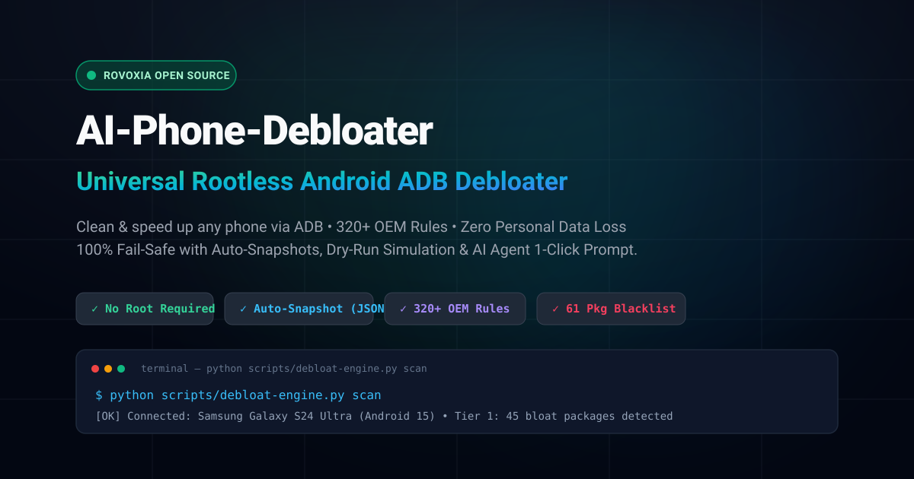

<div align="center">

# AI-Phone-Debloater

**The Universal, Rootless Android Debloater & Bloatware Removal Engine**  
*Built for AI Coding Agents (Claude Code, ChatGPT, Cursor, Gemini) & Terminal Power Users.*

<br />

<p align="center">
  <a href="https://debloater.rovoxia.com">
    
  </a>
</p>

[](LICENSE)
[](https://www.python.org/)
[](https://developer.android.com)
[-teal.svg?style=flat-square)](cli/src/debloat_engine.py)
[](#technical-safety-architecture)
[-success.svg?style=flat-square)](#frequently-asked-questions)
[](https://github.com/Rovoxia/AI-Phone-Debloater/actions)
[](cli/rules/)
[](#quick-facts--technical-summary)

<p align="center">
  <a href="https://debloater.rovoxia.com">🌐 Official Website</a> •
  <a href="#quickstart">⚡ Quickstart</a> •
  <a href="https://debloater.rovoxia.com/prompt.md">🤖 Master AI Prompt</a> •
  <a href="#safety-tiers">🛡️ Safety Tiers</a> •
  <a href="#oem-coverage-matrix">📱 OEM Coverage</a> •
  <a href="#comparison-matrix">📊 Comparison</a> •
  <a href="#frequently-asked-questions">❓ FAQ</a>
</p>

</div>

---

<a id="quick-facts--technical-summary"></a>
## 💡 Quick Facts & Technical Summary

Key technical facts and specifications:

| Question | Direct Answer & Technical Specification |
| :--- | :--- |
| **What is AI-Phone-Debloater?** | An open-source, rootless Android bloatware removal engine powered by Python stdlib and standard ADB commands. |
| **Is root required?** | **No root required.** Operates strictly via Android user-space (`User 0`) permissions (`pm disable-user`, `pm uninstall -k`). |
| **Does it trip Samsung Knox or void warranty?** | **No.** Knox Warranty Void remains `0x0`. Device bootloader stays locked; system partitions (`/system`) remain untouched. |
| **Do banking apps and Google Pay continue working?** | **Yes.** Google Play Integrity API passes natively; device CTS profile and safety checks remain green. |
| **Are package removals reversible?** | **100% reversible.** Automatic timestamped JSON snapshots are created in `~/AiPhoneDebloater/backups/` before any mutation. |
| **Can critical system packages be removed accidentally?** | **No.** Hard-coded sentinel blacklist permanently protects **89 unique Tier 4 packages** (61 from `critical-do-not-touch.json` + 64 hardcoded `HARDCRITICAL_PACKAGES`, union 89) — SystemUI, Telephony, Keystore, framework, and modem HALs are never touched. |
| **What platforms are supported?** | Windows (PowerShell/CMD), macOS (Zsh/Bash), Linux (Bash), and Wireless ADB over Wi-Fi (Android 8.0 to 15+). |

---

## 📌 Executive Summary

**AI-Phone-Debloater** is an open-source, rootless Android optimization engine designed to safely freeze, disable, and uninstall preloaded carrier bloatware, aggressive OEM surveillance daemons, and background telemetry services without voiding your warranty or tripping tamper fuses.

Unlike legacy debloating scripts that execute unvetted package removal commands blindly, AI-Phone-Debloater introduces a **4-Tier Safety Model**, a **hard-coded sentinel blacklist of 89 unique Tier 4 critical OS packages**, and an **automatic JSON rollback snapshot manager**. It operates strictly in Android user-space (`User 0`) with zero external pip dependencies — running entirely on Python's standard library and the official Android Debug Bridge (`adb`).

### 🚀 Key Performance & Privacy Benchmarks
- **⚡ 1.5GB to 3GB+ RAM Reclaimed:** Terminates background autostart services and resident bloatware daemons.
- **🔋 20% to 30% Extended Battery Endurance:** Eliminates aggressive background wakelocks, telemetry polling, and ad-rendering services.
- **🛡️ 100% Reversible & Safe:** Modifies only User 0 package registration state while keeping application private caches intact via the `-k` preservation flag.
- **🔒 Knox 0x0 & Play Integrity Verified:** Rootless architecture ensures banking applications, Google Wallet, Netflix HD, and Samsung Knox remain 100% functional.

> [!WARNING]
> ### ⚠️ Safety & Best Practices Notice • `No Root Required`
> Uses safe User 0 commands (`disable-user` / `uninstall -k`) with 61 core OS packages hard-blocked. Because OEM skins vary, Tier 2/3 removal may disrupt dependent features. **Always back up important photos, chats, and data before modifying packages.**

---

## 🧭 Navigation

- [💡 Quick Facts & Technical Summary](#quick-facts--technical-summary)
- [⚡ Quickstart: 3 Ways to Debloat](#quickstart)
  - [Option A: 1-Click Master AI Agent Prompt](#option-a-1-click-master-ai-agent-prompt-recommended)
  - [Option B: Zero-Git Single-Command Runners](#option-b-zero-git-single-command-runners)
  - [Option C: Interactive Local CLI & Wireless ADB](#option-c-interactive-local-cli--wireless-adb)
- [🛡️ 4-Tier Safety Model](#safety-tiers)
- [📊 Comparison Matrix](#comparison-matrix)
- [📱 OEM Coverage Matrix](#oem-coverage-matrix)
- [🔬 Technical Safety Architecture](#technical-safety-architecture)
- [💻 CLI Engine Command Reference](#cli-engine-command-reference)
- [🔄 Rollback & Disaster Recovery](#rollback-disaster-recovery)
- [❓ Frequently Asked Questions](#frequently-asked-questions)
- [🤝 Contributing & Community](#contributing-community)

---

<a id="quickstart"></a>
## ⚡ Quickstart: 3 Ways to Debloat

Choose the debloating workflow that matches your preferred environment:

### Option A: 1-Click Master AI Agent Prompt (Recommended)

Feed our canonical debloating prompt directly into **Claude Code CLI**, **ChatGPT**, **Cursor**, **Gemini**, or **Cline**. The AI agent will auto-detect your device, cross-reference installed packages against OEM databases, simulate changes via a dry-run report, and safely apply debloating rules with your confirmation.

<p align="left">
  <a href="https://debloater.rovoxia.com/prompt.md">
    
  </a>
</p>

---

### Option B: Zero-Git Single-Command Runners

Run the debloat engine immediately without cloning the git repository or configuring manual PATH variables:

#### Windows (PowerShell 5.1 / 7+)
```powershell
irm https://debloater.rovoxia.com/run.ps1 | iex
```

#### macOS / Linux (Bash / Zsh)
```bash
curl -sSL https://debloater.rovoxia.com/run.sh | bash
```

*What this does:* Downloads the lightweight engine into `$HOME/.ai-phone-debloater`, verifies Python 3, checks ADB connectivity, and launches the interactive terminal menu.

---

### Option C: Interactive Local CLI & Wireless ADB

Clone the repository locally and run the cross-platform launcher:

```bash
# 1. Clone the repository
git clone https://github.com/Rovoxia/AI-Phone-Debloater.git
cd AI-Phone-Debloater

# 2. Launch the Interactive Dashboard
# On Windows:
cli\bin\debloat.bat

# On macOS / Linux:
bash cli/bin/debloat.sh
```

#### 📶 Wireless ADB Mode (No USB Cable Required)
Connect your phone and PC to the same Wi-Fi network, enable **Wireless Debugging** in Developer Options, and run:
```bash
python cli/src/debloat_engine.py --wireless 192.168.1.50:5555
```
*(The engine also supports automatic zero-configuration pairing via mDNS discovery on Android 11+).*

---

<a id="safety-tiers"></a><a id="4-tier-safety-model"></a>
## 🛡️ 4-Tier Safety Model

Every Android package evaluated by AI-Phone-Debloater is classified strictly into one of four safety tiers:

| Tier | Category | Description | Typical Packages | Risk Level |
| :---: | :--- | :--- | :--- | :---: |
| **Tier 1** | **Safe Bloat** *(Default)* | Carrier junk, third-party partner apps, aggressive ad daemons, diagnostic telemetry loggers. | `com.miui.msa.global`<br>`com.facebook.katana`<br>`com.amazon.appmanager`<br>`com.netflix.partner.activation` | 🟢 **Zero Risk**<br>(Safe for all users) |
| **Tier 2** | **Advanced Debloat** | Secondary voice assistants, OEM cloud synchronization, AR stickers, wellbeing trackers. | `com.samsung.android.bixby.agent`<br>`com.miui.cloudservice`<br>`com.samsung.android.arzone`<br>`com.google.android.apps.wellbeing` | 🟡 **Low Risk**<br>(Review feature usage) |
| **Tier 3** | **Extreme Debloat** | Replaceable stock apps (keyboards, stock dialers, default SMS, OEM gallery apps, updaters). | `com.samsung.android.honeyboard`<br>`com.miui.gallery`<br>`com.google.android.dialer`<br>`com.sec.android.app.myfiles` | 🟠 **Moderate Risk**<br>(Install replacement first) |
| **Tier 4** | **Critical Core** *(Sentinel)* | Android framework, telephony call routing, modem HALs, keystore encryption, package installer. | `android`<br>`com.android.systemui`<br>`com.android.phone`<br>`android.security.keystore` | 🔴 **HARD-BLOCKED**<br>(Never touched) |

> [!WARNING]
> ### ⚠️ Safety & Best Practices Notice • `No Root Required`
> Uses safe User 0 commands (`disable-user` / `uninstall -k`) with 61 core OS packages hard-blocked. Because OEM skins vary, Tier 2/3 removal may disrupt dependent features. **Always back up important photos, chats, and data before modifying packages.**

### ⚙️ How Safety Tiers Work (Engine Decision Pipeline)

1. **Inviolable Core Sentinel (Tier 4 Guardrail)**  
   The engine initializes by loading 61 critical operating system packages from `cli/rules/critical-do-not-touch.json` and internal kernel safeguards into memory. Any package marked as Tier 4 (`com.android.systemui`, telephony stack, keystore biometrics) is **permanently blocked** and cannot be removed, frozen, or bypassed by any argument or AI prompt.

2. **OEM Skin Auto-Discovery & Dynamic Rules**  
   The engine queries device properties via ADB (`ro.product.manufacturer`, `ro.product.model`) and dynamically matches the corresponding OEM rulebook (`samsung-oneui.json`, `xiaomi-miui-hyperos.json`, `oneplus-oxygenos.json`, `google-pixel.json`, etc.) alongside `universal-safe-to-remove.json`.

3. **Classification & Targeted Debloat**  
   - **`--tier 1` (Safe Bloat):** Recommended default. Freezes carrier junk, partner bloat (Facebook, Netflix, Microsoft), and telemetry loggers without affecting any OS features.
   - **`--tier 2` (Advanced):** Freezes secondary OEM assistants (Bixby, Celia), OEM cloud sync, and AR sticker utilities. Safe if you don't use those specific OEM features.
   - **`--tier 3` (Extreme):** Targets replaceable stock utilities (OEM dialer, stock keyboard, gallery). Prerequisite: Install a third-party replacement app (e.g., Gboard, Google Phone) first.

4. **Dry-Run Simulation Before Execution**  
   Run `python cli/src/debloat_engine.py --tier 1 --dry-run` to inspect a full table of proposed changes, package descriptions, and reasons before modifying your device.

5. **Automated Rollback Snapshot & Reversible State**  
   Before any package state is changed, an automated timestamped JSON snapshot (`~/AiPhoneDebloater/backups/snapshot_<model>_<timestamp>.json`) is saved safely in your user home directory. Debloat commands use `disable-user` or `uninstall -k` (which preserves user application data in `/data/user/0/`), enabling instant 1-click restore via `--restore <SNAPSHOT>`.

---

<a id="comparison-matrix"></a>
## 📊 Comparison Matrix

How AI-Phone-Debloater compares against traditional Android debloating solutions:

| Feature / Capability | AI-Phone-Debloater | UAD-ng | ADB AppControl | Shizuku Based Tools | Manual ADB Shell |
| :--- | :---: | :---: | :---: | :---: | :---: |
| **AI Agent Native Integration** (Claude, Cursor, GPT) | ✅ **First-Class** | ❌ No | ❌ No | ❌ No | ❌ No |
| **Zero-Git Single-Command Runners** (`run.ps1`/`run.sh`) | ✅ **Yes** | ❌ No | ❌ No | ❌ No | ❌ No |
| **Python Standard Library Only** (0 pip install) | ✅ **Yes** | ❌ Rust binary | ❌ .NET binary | ❌ Android APK | ⚠️ Shell syntax |
| **Hard-Coded Protected Core Blacklist** (89 unique Tier 4) | ✅ **Inviolable** | ⚠️ Community list | ⚠️ Basic | ⚠️ None | ❌ None |
| **Automated JSON Rollback Snapshots** | ✅ **Automatic** | ⚠️ Partial | ⚠️ Paid edition | ❌ No | ❌ Manual |
| **Root Required?** | ❌ **No Root** | ❌ No Root | ❌ No Root | ❌ No Root | ❌ No Root |
| **Warranty & Samsung Knox Preservation** | ✅ **0x0 Safe** | ✅ 0x0 Safe | ✅ 0x0 Safe | ✅ 0x0 Safe | ✅ 0x0 Safe |
| **Cross-Platform Support** (Windows, macOS, Linux) | ✅ **Native** | ✅ Native | ❌ Windows only | 📱 On-device | ✅ Native |
| **Open Source License** | ✅ **MIT** | ✅ GPL-3.0 | ❌ Closed Source | ✅ Apache-2.0 | 🌐 N/A |

---

<a id="oem-coverage-matrix"></a>
## 📱 OEM Coverage Matrix

Curated rule databases located in `cli/rules/` cover **324 unique packages** across the major Android OEM skins (263 removable bloat + 61 Tier 4 critical hard-blocked):

| Manufacturer | System Skin | Rule Database File | Packages | Targeted Services |
| :--- | :--- | :--- | :---: | :--- |
| **Samsung** | One UI 1.0 – 6.1+ | [`samsung-oneui.json`](cli/rules/samsung-oneui.json) | 44 | Bixby, AR Zone, Game Optimizing Service (GOS), Knox Analytics, Link to Windows, Quick Share telemetry. |
| **Xiaomi / POCO / Redmi** | HyperOS & MIUI 10 – 14 | [`xiaomi-miui-hyperos.json`](cli/rules/xiaomi-miui-hyperos.json) | 27 | MSA Ad Service, Joyose daemon, Mi Pay, GetApps store, Analytics, Hybrid Accessory, Mi Browser. |
| **Google** | Pixel Experience | [`google-pixel.json`](cli/rules/google-pixel.json) | 23 | Pixel Tips, Ambient Music Recognition, Device Personalization Services, ARCore, Feedback loggers. |
| **OnePlus** | OxygenOS & ColorOS Base | [`oneplus-oxygenos.json`](cli/rules/oneplus-oxygenos.json) | 19 | HeyTap Cloud, OPBugreport, Membership services, LogKit, Dirac Sound, Red Cable Club promo daemons. |
| **Oppo / Vivo / Realme** | ColorOS, Funtouch, Realme UI | [`bbk-oppo-vivo-realme.json`](cli/rules/bbk-oppo-vivo-realme.json) | 21 | HeyTap Cloud, Game Space overlay, Jovi voice services, V-Appstore, Theme Store push daemons. |
| **Motorola** | My UX & Hello UI | [`motorola.json`](cli/rules/motorola.json) | 15 | Moto Display, Moto Suggestions, Ready For analytics, Lenovo diagnostic telemetry. |
| **Transsion** | Tecno HiOS, Infinix XOS, itel | [`transsion-tecno-infinix.json`](cli/rules/transsion-tecno-infinix.json) | 29 | Palm Store, Carlcare telemetry, AHA Games, Phone Master optimization ads, HiOS launcher ads. |
| **Huawei** | EMUI | [`huawei-emui.json`](cli/rules/huawei-emui.json) | 4 | EMUI-specific bloat and telemetry daemons. |
| **Universal (All OEMs)** | Cross-Carrier & Preloads | [`universal-safe-to-remove.json`](cli/rules/universal-safe-to-remove.json) | 81 | Facebook AppManager / Installer, Microsoft OneDrive / Link, Netflix Activation, Google Partner Setup. |
| **Critical Core (Sentinel)** | Tier 4 — never touched | [`critical-do-not-touch.json`](cli/rules/critical-do-not-touch.json) | 61 | Android framework, telephony, keystore, package installer — hard-blocked. |

**Total:** 324 unique packages across 10 rule databases (263 removable bloat + 61 Tier 4 critical hard-blocked).

---

<a id="technical-safety-architecture"></a>
## 🔬 Technical Safety Architecture

### 1. Rootless User 0 Execution
Android isolates user application registrations from the base system image. When AI-Phone-Debloater disables or uninstalls a package, it runs:
```bash
adb shell pm disable-user --user 0 <package_name>
# or
adb shell pm uninstall -k --user 0 <package_name>
```

### 2. Physical Partitions Remain Untouched (`dm-verity` Intact)
Modern Android devices store system APKs inside read-only partitions (`/system`, `/product`, `/vendor`, `/system_ext`) protected by **dm-verity** (kernel-level cryptographic verification). Modifying these partitions requires bootloader unlocking and trips safety hashes. AI-Phone-Debloater **never** modifies `/system`. It only alters the application registration database for User 0, ensuring bootloader integrity remains untouched.

### 3. Application Data Directory Preservation (`-k` Flag)
When executing uninstalls, the `-k` parameter instructs Android's Package Manager to preserve the app's private data directory located in `/data/user/0/<package_name>/`. If an application is re-installed or re-enabled later, accounts, local preferences, and session tokens are preserved.

### 4. Code-Level Sentinel Blacklist
The core engine enforces a hard-coded set of 61 fundamental operating system packages in `cli/src/debloat_engine.py` and `cli/rules/critical-do-not-touch.json`. Even if an AI agent, custom rule, or user argument commands the removal of packages such as `com.android.systemui` or `com.android.phone`, the engine **intercepts and aborts** the action immediately before execution.

---

<a id="cli-engine-command-reference"></a>
## 💻 CLI Engine Command Reference

The core engine is located at `cli/src/debloat_engine.py` and supports full non-interactive automation:

```bash
# Scan and audit all packages on the connected device
python cli/src/debloat_engine.py --scan

# Export scan results to JSON for AI analysis
python cli/src/debloat_engine.py --scan --export-json --output device_profile.json

# Run dry-run simulation for Tier 1 bloat (read-only, no modifications)
python cli/src/debloat_engine.py --tier 1 --dry-run

# Execute safe freezing for Tier 1 packages (recommended action)
python cli/src/debloat_engine.py --tier 1 --action disable

# Execute safe uninstallation for Tier 1 packages (keeps app data via -k)
python cli/src/debloat_engine.py --tier 1 --action uninstall

# Non-interactive script mode (bypasses terminal confirmation)
python cli/src/debloat_engine.py --tier 1 --action disable --yes

# Connect to device over Wireless ADB
python cli/src/debloat_engine.py --wireless 192.168.1.100:5555

# Target specific device when multiple phones are connected
python cli/src/debloat_engine.py --serial R58M123456X --tier 1 --action disable

# Restore device state from a timestamped snapshot
python cli/src/debloat_engine.py --restore snapshot_SM-S911B_20261101_120000.json
```

---

<a id="rollback-disaster-recovery"></a>
## 🔄 Rollback & Disaster Recovery

Every action performed by AI-Phone-Debloater is 100% reversible:

### 1. Automated Snapshot Restore (1-Click)
Before executing changes, the engine creates a timestamped JSON snapshot under `~/AiPhoneDebloater/backups/`:
```bash
python cli/src/debloat_engine.py --restore <SNAPSHOT_FILENAME>
```

### 2. Manual Raw ADB Single-Package Recovery
If you ever need to restore an individual app without running the full engine:

```bash
# Re-enable a disabled app:
adb shell pm enable <package_name>

# Reinstall an uninstalled-for-user app (restores APK with preserved data):
adb shell cmd package install-existing --user 0 <package_name>
```

---

<a id="frequently-asked-questions"></a>
## ❓ Frequently Asked Questions

<details>
<summary><strong>Do I need root access to debloat my phone?</strong></summary>
<p><strong>No.</strong> AI-Phone-Debloater operates 100% rootless using standard Android Debug Bridge (ADB) User 0 permissions. Your bootloader remains locked, Samsung Knox counter stays 0x0, warranty remains valid, and banking apps keep functioning normally.</p>
</details>

<details>
<summary><strong>Will debloating affect OTA system software updates?</strong></summary>
<p><strong>No.</strong> Because debloating operates at the User 0 level without altering read-only system partitions (dm-verity remains intact), official manufacturer OTA updates continue to download and install normally.</p>
</details>

<details>
<summary><strong>Will debloating trip Samsung Knox or break Google Pay?</strong></summary>
<p><strong>No.</strong> Samsung Knox Warranty Void fuse (0x0) is only triggered when flashing unauthorized bootloader binaries or custom recovery kernels. Because this tool never writes to the kernel or boot partition, Knox stays 0x0 and Google Play Integrity API passes.</p>
</details>

<details>
<summary><strong>Can I restore an uninstalled app later?</strong></summary>
<p><strong>Yes.</strong> Preloaded system apps live on the read-only system image and are only unregistered for User 0. You can re-register any app instantly using <code>adb shell cmd package install-existing &lt;package&gt;</code> or with our snapshot restore manager.</p>
</details>

<details>
<summary><strong>What is the difference between disable and uninstall?</strong></summary>
<p><code>disable</code> freezes the app in place so it cannot execute or consume background memory. <code>uninstall</code> (via <code>pm uninstall -k --user 0</code>) unregisters the package completely from User 0 while retaining user database files. We recommend <code>disable</code> as the safest primary choice.</p>
</details>

<details>
<summary><strong>How do I undo all changes if I sell or service my phone?</strong></summary>
<p>Run <code>python cli/src/debloat_engine.py --restore &lt;snapshot&gt;</code> to revert all packages to their exact previous state. Alternatively, a factory reset returns the device to factory stock condition since read-only system partitions (<code>/system</code>) are never altered.</p>
</details>

<details>
<summary><strong>Which Android versions are supported?</strong></summary>
<p>AI-Phone-Debloater supports <strong>Android 8.0 (Oreo) through Android 15+</strong>. On Android 11+, zero-cable Wireless ADB debugging with automated mDNS pairing is natively supported.</p>
</details>

---

<a id="contributing-community"></a>
## 🤝 Contributing & Community

Contributions are welcomed! We actively accept pull requests for new OEM rule databases, bug fixes, and documentation improvements.

1. Review [CONTRIBUTING.md](CONTRIBUTING.md) and [SAFETY_GUIDELINES.md](SAFETY_GUIDELINES.md).
2. Validate any proposed rule changes locally using our test suite:
   ```bash
   python cli/tests/validate_rules.py
   ```
3. Open a Pull Request referencing the OEM model and Android version tested.

---

## 📄 License

This project is open-source software licensed under the [MIT License](LICENSE).  
Copyright © 2026 [Rovoxia](https://rovoxia.com). All rights reserved.
